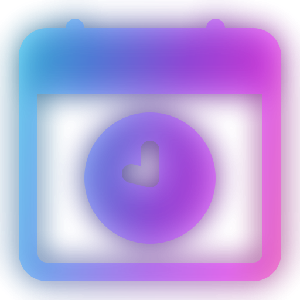

# Zetta Download Manager

  

  <strong>One app to download everything — no extra tools needed.</strong>

  
  
  

---

## My idea

The idea is simple: **one program that downloads everything** — files, videos, audio, playlists and whatever — without depending on any external program.

Zetta is still **under active development** and there is a lot more to develop, but here's what it already done.

> [!NOTE]
> This is **not open source**. What you see here is only a portion of the source code, not the full codebase.

---

##  What You Get Right Now

### Full-Speed File Downloads
Download any file from any website at your **maximum internet speed**. Many download managers can't handle every site — that's why IDM has stayed relevant for so long. Zetta is built to change that: delivering **IDM-level (and beyond) download quality, completely free**. I believe what's already here surpasses IDM in several ways.

###  Video Downloads — Straight From Your Browser
See a video playing in your browser? **Grab it directly.**

- **Multiple dubs?** Pick the dubbing language you want
- **Video quality?** Choose your preferred resolution
- **Audio quality?** Select the bitrate that suits you
- **Transcript available?** Download it right alongside the video

###  Full Playlist Downloads
Download an **entire playlist** in one go with full control over:

- Video quality selection
- Audio quality selection
- Audio-only mode (perfect for music playlists)

###  Audio Downloads
Need just the audio? Zetta handles that too — download audio tracks directly with quality control.

---

##  Screenshots

  

<em>Adding a new download</em>

  

<em>Managing download queues</em>

  

<em>Built-in download scheduler</em>

  

<em>Settings & options</em>

---

## 🌐 Browser Extension

1. Open `chrome://extensions`
2. Enable **Developer Mode**
3. Click **Load Unpacked** → select the `ext/` folder

---

This project is under development. Stay tuned.

